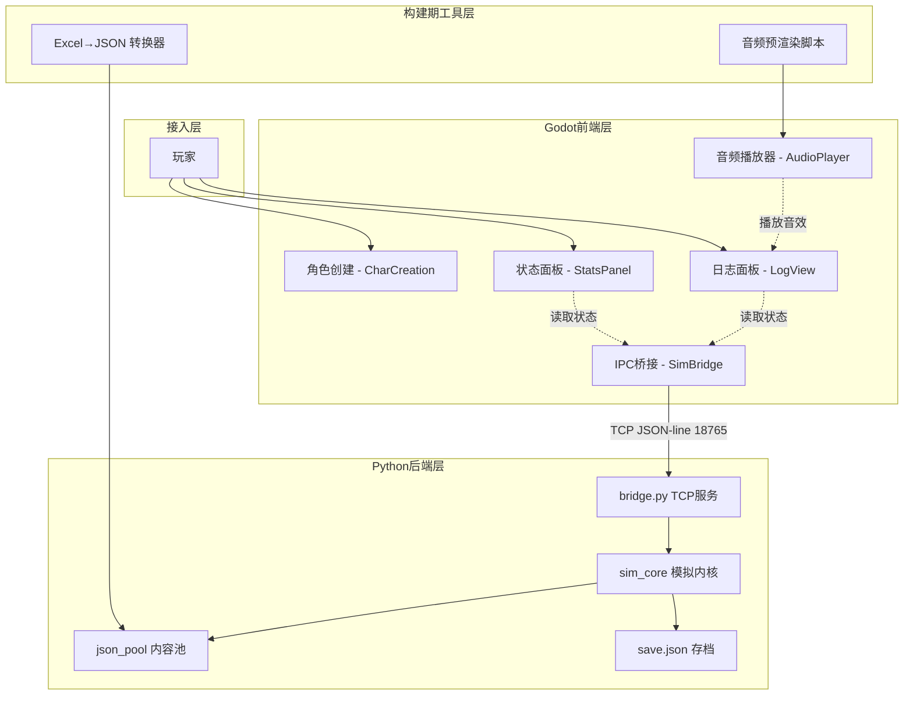
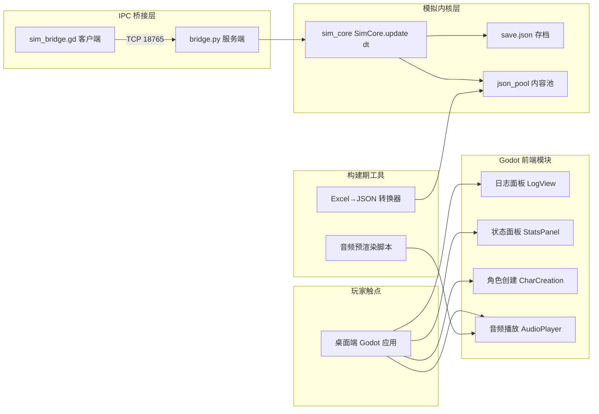

# AICoding 架构设计 · 高层架构设计

> 本文档为《AICoding 架构设计》核心产物之一，对应**高层架构设计模版**。
> 上游输入：业务原始诉求 + 行业调研结论 + 现有架构知识库；
> 下游输出：驱动《系统设计》《部署设计》《安全设计》《UserStory》四份文档的撰写。

---

## 0. 元信息：修订记录

```yaml
标题: BeeIdleRPG（蜂蜜挂机 RPG）- 高层架构设计 v1.0
版本: v1.0
状态: Draft
创建日期: 2026-07-15
最后更新: 2026-07-15
作者: team-lead（主理人）
评审人:
  - 全哥（项目负责人 / 独立开发者）

关联文档:
  上游输入:
    - 业务原始诉求: 基于 D:\allin\right\bee 项目（BeeIdleRPG）生成完整架构方案
    - 行业调研报告: research_report.md v1.0
    - 资料摘要: material_digest.md v1.0
    - 现有架构知识库: ADR-0001 SIGNED-OFF / m1-report.md / migration-plan.md
  下游产出:
    - 系统设计: 系统设计.md
    - 部署设计: 部署设计.md
    - 安全设计: 安全设计.md
    - UserStory: UserStory.md
```

| 版本 | 日期 | 作者 | 变更内容 | 评审状态 |
| --- | --- | --- | --- | --- |
| v1.0 | 2026-07-15 | team-lead（主理人） | 初稿，覆盖 §1~§6 全部章节 | Draft |

> **版本管理纪律**：破坏性变更（章节结构调整 / 关键决策反转）升 MAJOR；新增章节、扩充内容升 MINOR。

---

## 1. 需求概要

### 1.1 需求概要说明

BeeIdleRPG 是一款 Progress Quest 风格、玩家零输入的文字挂机 RPG，当前以 Python/Tkinter 实现（~9,570 行 src/ 源码），sim_core 已抽取完成（8,466 行纯 Python 模拟内核，golden test 139/139 一致）。用户已签核 ADR-0001 采纳 B/C 路线迁移至 Godot 4 引擎，当前处于 M2 阶段（Godot 原型验证）。本期需求是完成引擎迁移的架构设计——在保留 sim_core 投资的前提下，以 Godot 4 为前端、TCP JSON-line IPC 为桥接层，实现桌面端跨平台发布能力。

### 1.2 关键决策摘要

| 编号 | 决策类别 | 决策内容 | 关联章节 |
| --- | --- | --- | --- |
| D1 | 范围决策 | 本期覆盖 Godot 4 桌面端前端 + TCP IPC 桥接 sim_core + 音频预渲染迁移 + 存档兼容；Web 导出、移动端、云端后端均不在 MVP 范围 | §6.1 需求边界 |
| D2 | 技术选型决策 | 桥接方案采用 B2 TCP JSON-line IPC（127.0.0.1:18765），否决 B1 GDExtension（实验性，2.95分）；音频采用构建期预渲染 WAV + 运行期 AudioStreamWAV 播放 | §3.2 / §4 |
| D3 | MVP / 完整版边界 | MVP = 桌面端 Godot 前端 + IPC + sim_core 复用 + save.json 兼容 + 预渲染音频；完整版追加 Web 导出（WebSocket 适配）+ 移动端 + 云端后端 | §4.3 |
| D4 | 复用 vs 新建 | sim_core 8,466 行整体复用（零改动）；IPC 脚手架（sim_bridge.gd）复用+扩展；Godot 前端 UI 新建；音频管线新建（预渲染脚本） | §5.2 |
| D5 | 部署形态 | 本地桌面应用（Windows/Linux/macOS），单机离线运行，PyInstaller 打包 sim_core 为独立可执行文件，Godot 一键导出前端 | §5.2 / 部署设计 |

**硬指标**：≥ 3 条，≤ 5 条；每条决策必须能映射到正文具体章节。 ✅ 5 条，全部可映射。

### 1.3 价值主张

| 价值维度 | 量化目标 | 度量指标 | 当前值 | 目标值 | 截止时间 |
| --- | --- | --- | --- | --- | --- |
| 效率 | 桌面端跨平台发布能力达成 | 支持的桌面平台数 | 1（Windows via PyInstaller） | 3（Windows/Linux/macOS via Godot 导出） | MVP 上线 |
| 成本 | sim_core 代码复用率 | 复用行数 / 总模拟行数 | 8,466 / 8,466（100%） | ≥ 95%（IPC 适配增量 ≤ 500 行） | MVP 上线 |
| 体验 | 游戏启动到首帧渲染时间 | 冷启动耗时（秒） | ~2s（Tkinter+PyInstaller） | ≤ 3s（Godot+IPC 子进程启动） | MVP 上线 |
| 效率 | IPC 帧延迟占帧预算比例 | step() 平均延迟 / 50ms | N/A（UNVERIFIED） | ≤ 10%（即 step() ≤ 5ms） | M2 验证完成 |
| 体验 | 存档兼容性 | save.json 跨引擎读写一致率 | 100%（Tkinter 内部） | 100%（Tkinter↔Godot 双向兼容） | MVP 上线 |

**硬指标**：业务价值 ≥ 2 条 + 技术/成本价值 ≥ 1 条；每条必须可量化。 ✅ 业务价值 2 条（跨平台/存档兼容）+ 技术/成本价值 3 条（复用率/帧延迟/启动时间）。

---

## 2. 需求分析 & 痛点解构

### 2.1 核心角色关注点

> 按"甲方决策者 / 最终用户 / 受影响方"维度盘点角色诉求。本系统涉及三类核心角色：甲方决策者角色（全哥，独立开发者，关注迁移停滞风险）、最终用户角色（idle RPG 玩家，关注游戏体验不退化）、受影响方角色（运维/工具链，关注打包分发与内容管线兼容性）。开发者角色（全哥）同时承担甲方与运维职责。

| 角色 | 业务身份 | 主要操作 | Top1 关心点 | 来源 |
| --- | --- | --- | --- | --- |
| 全哥（甲方决策者） | 独立开发者 / 项目负责人 | 架构决策 / 代码编写 / 发布管理 | 迁移停滞风险——一人团队能否扛住引擎迁移的维护成本 | ADR-0001 §4 R5 |
| 玩家（最终用户） | idle RPG 爱好者 | 挂机观战 / 角色创建 / 存档管理 | 游戏可正常运行不卡顿——迁移后体验不低于 Tkinter 版 | material_digest D1 §0 |
| 全哥（受影响方：运维） | 开发者兼运维 | 打包发布 / 分发更新 | 打包分发复杂度——Godot 导出 + Python 子进程的分发是否可控 | research_report R-02 |
| 内容工具链（受影响方） | Excel→JSON 构建管线 | 运行构建期转换 | 24 表 JSON 池原样复用——迁移不应破坏内容工具链 | material_digest D3 §5 |

**硬指标**：≥ 3 类（甲方决策者 / 最终用户 / 受影响方各至少一行）。 ✅ 4 类，覆盖决策者/最终用户/运维/工具链。

### 2.2 核心痛点

| 编号 | 痛点描述 | 现象 / 数据 | 影响角色 | 影响程度 | 优先级 |
| --- | --- | --- | --- | --- | --- |
| P1 | Tkinter 跨平台能力受限——无法在 macOS/Linux 上原生运行，无 Web/移动端导出路径 | 当前仅支持 Windows（PyInstaller 打包），macOS/Linux 需手动配置 tkinter 环境 | 全哥 / 玩家 | 高（分发能力瓶颈） | P1 |
| P2 | sim_core 与 UI 耦合虽已抽取，但 Tkinter 前端无法独立演进——game_controller 仍为 161 行薄前端但绑死 Tkinter 事件循环 | root.after(50, _game_loop) 驱动模拟，离开 Tkinter 主循环 sim_core 无法驱动 | 全哥 | 高（架构约束） | P1 |
| P3 | 音频系统依赖 numpy/scipy/sounddevice 程序化合成，是 Python 专属——迁移到 Godot 后需重建音频管线 | 44KB 音频代码（requirements.txt 依赖 sounddevice/numpy/scipy），Godot 无对应 Python 库 | 全哥 | 中（功能完整性） | P2 |
| P4 | 一人团队学习 GDScript + Godot 编辑器 + IPC 调试的认知负荷——迁移过程中可能遇到阻塞性问题导致项目长期停滞 | 独立开发者，无团队协作，迁移期间无法同时推进新功能 | 全哥 | 高（项目可行性） | P1 |

**优先级标准**：
- **P1**：直接影响业务核心流程或合规底线，不解决无法上线。
- **P2**：影响用户体验或运营效率，可在 MVP 后迭代。
- **P3**：体验型 / 长尾问题，列入完整版或后续版本。

**硬指标**：每条痛点必须有"现象 / 数据"佐证；P1 ≥ 1 条且必须在 §2.3 有对应目标。 ✅ P1 有 3 条（P1/P2/P4），全部在 §2.3 有对应目标。

### 2.3 期待目标

| 编号 | 目标描述 | 对齐痛点 | 度量指标 | 当前值 | 目标值 | 截止时间 |
| --- | --- | --- | --- | --- | --- | --- |
| V1 | Godot 4 桌面端可运行 idle RPG 完整游戏循环 | P1, P2 | 桌面平台数（Windows/Linux/macOS） | 1 | 3 | MVP 上线 |
| V2 | sim_core 零改动通过 IPC 被 Godot 前端驱动 | P2 | golden test 一致率 | 139/139（Tkinter 内部） | 139/139（IPC 驱动） | M2 验证完成 |
| V3 | 音频系统迁移至 Godot 原生播放 | P3 | 音效覆盖数 | 全部音效（Python 合成） | 全部音效（预渲染 WAV） | MVP 上线 |
| V4 | 迁移过程不阻塞新功能开发——Tkinter 旧前端保留为回退 | P4 | 旧前端可用性 | 可用（当前唯一前端） | 可用（回退方案） | 迁移全程 |
| V5 | IPC 帧延迟在可接受范围内 | P1, P4 | step() 平均延迟 | N/A（UNVERIFIED） | ≤ 5ms（帧预算 50ms 的 10%） | M2 验证完成 |

**硬指标**：每条目标必须有数字 + 对齐至少 1 条痛点；P1 痛点必须有对应 V 级目标。 ✅ 全部满足。

### 2.4 基线复用

| 复用类别 | 现有能力 | 复用方式 | 来源系统 | 备注 |
| --- | --- | --- | --- | --- |
| 模拟内核 | sim_core 8,466 行（19 service + 6 model + engine.py + json_pool） | 整体复用，零改动，通过 IPC 被 Godot 驱动 | BeeIdleRPG src/sim_core/ | golden test 139/139 一致，Gate 1 PASS |
| 存档系统 | save.json（to_dict/from_dict 序列化） | 原样复用，schema 冻结 | BeeIdleRPG sim_core | 引擎无关 JSON 格式 |
| 内容管线 | Excel→JSON 构建期转换（excel_to_json.py / excel_service.py 44KB） | 保留构建期使用，运行期只读 JSON 池 | BeeIdleRPG 构建工具 | 24 张表 → JSON 池 |
| IPC 脚手架 | sim_bridge.gd + bridge.py（TCP JSON-line 127.0.0.1:18765） | 复用 + 扩展（补 WebSocket 适配留作完整版） | BeeIdleRPG godot/ | 状态 UNVERIFIED，需 M2 验证 |
| 黄金安全网 | test_sim_core_golden.py + golden_baseline.json | 原样保留，IPC 驱动后新增 test_sim_bridge.py | BeeIdleRPG tests/ | 139 行日志 + 状态指纹 |
| 音频合成代码 | numpy/scipy 程序化合成（44KB） | 转为构建期预渲染工具，生成 WAV 文件 | BeeIdleRPG 音频模块 | 运行期改用 Godot AudioStreamWAV |
| 配置体系 | settings.py（模拟参数 / UI 参数分离） | sim_core.config.settings 复用，UI 参数迁入 Godot | BeeIdleRPG sim_core/config/ | 单源防漂移 |

**硬指标**：必须先盘点再决定新建；凡列入"功能缺口"的能力，必须先在本节确认基线无法覆盖。 ✅ 全部基线能力已盘点。

### 2.5 功能缺口

| 阶段 | 功能缺口 | 必要性 | 优先级 | 对齐目标 |
| --- | --- | --- | --- | --- |
| 引擎迁移 | Godot 4 前端 UI 层（日志面板 + 状态面板 + 角色创建对话框） | 必须 | MVP | V1 |
| 引擎迁移 | Python 子进程管理（Godot 前端启动/监控/退出 sim_core 桥接服务） | 必须 | MVP | V1, V4 |
| 引擎迁移 | IPC 性能验证与优化（M2 核心任务） | 必须 | MVP | V2, V5 |
| 音频迁移 | 构建期音频预渲染脚本（numpy/scipy → WAV 文件） | 必须 | MVP | V3 |
| 音频迁移 | Godot 端音频播放器（AudioStreamWAV 加载与播放） | 必须 | MVP | V3 |
| 打包分发 | PyInstaller 打包 sim_core + bridge 为独立可执行文件 | 必须 | MVP | V1 |
| 打包分发 | Godot 桌面端导出（Windows/Linux/macOS） | 必须 | MVP | V1 |
| 跨平台 | Web 导出 + WebSocket 适配层 | 重要 | 完整版 | V1（扩展） |
| 跨平台 | 移动端导出（Android/iOS） | 重要 | 完整版 | — |
| 云端 | sim_core 服务化（云端后端 + 多设备同步） | 可选 | 远期 | — |

**硬指标**：每条缺口必须对齐 §2.3 至少一条目标；MVP 缺口必须在 §6.3 功能清单中对应有 MVP 范围标记。 ✅ 全部满足。

---

## 3. 行业调研

### 3.1 行业标杆系统分析

| 标杆系统 | 厂商 / 来源 | 场景覆盖 | 技术亮点 | 商业模式 | 适用度 |
| --- | --- | --- | --- | --- | --- |
| B2 TCP JSON-line IPC Bridge | 自研 / GodotAIGym 先例 | Godot 前端通过 TCP 驱动 Python 后端 sim_core | 127.0.0.1:18765 JSON-line 协议；init/step/state/new_game/quit；1.7ms 延迟 | 自研 | 高 |
| B3 A Dark Forest（GodotProjectZero） | 开源社区（N0best1rn） | Godot 纯 GDScript 增量放置游戏 | 纯 GDScript + Resources 驱动；Steam + itch.io 发布 | 开源（MIT） | 中 |
| B4 Gaiadon: Eternal Quest | nadukkon（独立开发者） | Godot idle RPG，含装备/转生/宠物/Boss | Godot + HTML5 WebAssembly 导出；Steam + itch.io | 商业（免费 + Patreon） | 中 |
| B1 GDExtension Python Binding | 开源社区（py4godot 等） | Python-Godot 进程内嵌绑定 | CPython 解释器嵌入 Godot 运行时 | 开源（MIT） | 低 |

**硬指标**：≥ 3 家；至少包含 1 家头部 SaaS + 1 家开源/自研代表。 ✅ 4 家，B4 为商业代表，B2/B3 为开源/自研代表。

### 3.2 方案对标及优先级打分

**对比矩阵**（每行权重之和 = 1）：

| 评估维度 | 权重 | 权重理由 | B2 TCP IPC 得分 | B3 纯 GDScript 得分 | B4 Gaiadon 得分 | B1 GDExtension 得分 |
| --- | --- | --- | --- | --- | --- | --- |
| 场景契合度 | 0.30 | idle RPG 核心需求是保留 sim_core 投资 + 低渲染 UI + 自动推进 | 4 | 5 | 5 | 4 |
| 技术成熟度 | 0.25 | 一人团队无法承担实验性技术栈的稳定性风险 | 4 | 5 | 4 | 2 |
| 集成难度（反向） | 0.20 | sim_core 已完成抽取，方案对已有代码侵入性越低越好 | 5 | 2 | 2 | 3 |
| 成本（反向） | 0.15 | 一人团队资源有限，初始和长期维护成本均需可控 | 4 | 2 | 2 | 3 |
| 合规可控性 | 0.10 | 版本独立性、平台可移植性、分发自由度 | 4 | 5 | 5 | 2 |
| **加权总分** | **1.00** | — | **4.20** | **3.95** | **3.70** | **2.95** |

**结论摘要**：
- **优先借鉴**：B2 TCP JSON-line IPC Bridge — 加权总分 4.20，场景契合度高（idle RPG 低频更新，IPC 延迟仅占帧预算 3.4%），集成难度满分（sim_core 零改动，脚手架已存在），一人团队风险最低。**这是当前阶段对一人团队投资保护最好的方案。**
- **部分借鉴**：B3 A Dark Forest（纯 GDScript）— 加权总分 3.95。借鉴点：Godot 场景树架构、Resources 驱动模式、UI 组织方式、Steam/itch.io 发布流程。不借鉴：全量 GDScript 重写路径（8,466 行 sim_core + golden test 全部需移植，成本不可接受）。
- **不借鉴**：B1 GDExtension Python Binding — 加权总分 2.95。否决理由：三个社区项目均标注"实验性""非生产就绪"；GDExtension 在 Godot 4.0→4.1 间发生过二进制兼容性破坏；C++/Python/Godot 三栈调试复杂度对一人团队不可接受。

### 3.3 完整报告参考

- 完整报告链接：`research_report.md`（同目录）
- 调研工具：research-analyst（查有据）
- 调研日期：2026-07-15
- 调研归档：`C:\Users\13122\WorkBuddy\2026-07-15-08-00-04\.workbuddy\output\research_report.md`

---

## 4. 方案决策

### 4.1 价值定位澄清

```
对外价值（玩家侧）: 跨平台可玩——Windows/Linux/macOS 桌面端原生运行，未来可扩展至 Web 浏览器即开即玩
对内价值（开发侧）: 保留 8,466 行 sim_core 投资零改动复用 + 获得 Godot 跨平台导出能力 + sim_core 与 UI 彻底解耦
差异化价值        : 相比纯 GDScript 重写路径，IPC 方案在迁移期间保留 Tkinter 旧前端作为回退，迁移失败零损失
```

**与产品矩阵的关系**：BeeIdleRPG 在全哥的项目矩阵（D:/allin 下 313 个 Python 项目）中是一个独立的游戏产品，迁移后将成为首个 Godot 引擎项目，为后续 Godot 项目积累引擎经验。

### 4.2 系统定位澄清

| 维度 | 内容 |
| --- | --- |
| 系统名称 | BeeIdleRPG（蜂蜜挂机 RPG） |
| 系统类型 | 改造（引擎迁移：Python/Tkinter → Godot 4） |
| 部署形态 | 本地桌面应用（单机离线运行） |
| 多租户 | 否（单机游戏，无租户概念） |
| 服务对象 | 玩家（idle RPG 爱好者） |
| 上游依赖 | Python 3.8+ 运行时（PyInstaller 打包内含）；Excel→JSON 构建工具链（构建期） |
| 下游消费者 | 无（终端产品，无下游系统） |
| 边界（不做） | 不做在线多人 / 不做内购系统 / 不做反作弊（单机游戏无需） |

### 4.3 MVP 与完整版决策

| 阶段 | 时间窗 | 范围（功能编号） | 架构差异点 | 退出标准 | 不做（延后） |
| --- | --- | --- | --- | --- | --- |
| MVP | M2~M4 | F1~F8 | TCP IPC（桌面端）；预渲染音频；PyInstaller 打包 sim_core | golden test 139/139 一致 + 三平台桌面导出可运行 + 旧前端保留可回退 | F9~F12 |
| 完整版 | M5+ | + F9~F11 | WebSocket 适配（Web 端）；移动端导出测试 | Web 端可浏览器即开即玩 + 移动端基础验证 | F12（远期） |

**MVP 功能清单**：
- F1: Godot 4 前端 UI（日志面板 + 状态面板 + 角色创建）
- F2: TCP JSON-line IPC 桥接（init/step/state/new_game/quit）
- F3: sim_core 子进程管理（启动/监控/崩溃恢复/优雅退出）
- F4: save.json 存档兼容（schema 冻结，跨引擎读写）
- F5: 24 表 JSON 内容池原样复用
- F6: 构建期音频预渲染（numpy/scipy → WAV）
- F7: Godot 端音频播放（AudioStreamWAV）
- F8: 桌面端打包分发（Godot 导出 + PyInstaller sim_core）

**完整版追加**：
- F9: Web 导出 + WebSocket 适配层
- F10: 移动端导出（Android/iOS）
- F11: sim_core 云端服务化（多设备同步）

**远期**：
- F12: 纯 GDScript 重写 sim_core（消除 Python 依赖，当 GDScript 生态成熟且 sim_core 稳定后评估）

**演进纪律**（重要）：
- ✅ MVP 的架构骨架（IPC 协议 + sim_core 复用 + Godot 前端）必须是完整版的子集，WebSocket 适配只是在 TCP 上加一层传输替换。
- ✅ MVP 中 Mock 的能力：Web 导出使用 WebSocket 适配器替换 TCP（完整版替换计划已在 §4.3 列明）。
- ❌ 禁止：MVP 为了赶工而引入"完整版无法继承"的临时架构——IPC 协议 init/step/state/new_game/quit 冻结为接口契约，WebSocket 适配层只替换传输层不改变协议语义。

---

## 5. 业务架构设计

### 5.1 业务架构图



**图例说明**：
**三层架构说明**：本系统采用标准三层架构——接入层（玩家触点）负责用户交互，业务能力层（Godot 前端模块 + IPC 桥接层）承载核心业务逻辑，基础能力层（sim_core 模拟内核 + 存档 + 内容池 + 构建工具）提供底座/数据支撑。

- 实线 = 同步调用（TCP IPC / 函数调用）
- 虚线 = 数据读取 / 事件驱动
- 接入层 → 业务能力层 → 基础能力层（单向依赖，禁止反向）

### 5.2 系统依赖架构

| 依赖类型 | 系统 / 模块 | 提供方 | 依赖能力 | 接入方式 | 同步/异步 | 关键约束 |
| --- | --- | --- | --- | --- | --- | --- |
| 上游 | sim_core（8,466 行） | 全哥 | 模拟推进 SimCore.update(dt) + 存档读写 + 内容池 | TCP JSON-line IPC | 同步（请求-响应） | 端口 18765；单连接 listen(1)；协议 init/step/state/new_game/quit |
| 上游 | save.json | sim_core | 存档持久化 | 文件 I/O（sim_core 内部） | 同步 | schema 冻结 + 版本号；data/ 目录不迁不分叉 |
| 上游 | 24 表 JSON 池 | json_pool.py | 运行期内容数据 | 文件 I/O（sim_core 内部） | 同步 | 只读，不修改 JSON 池 |
| 复用底座 | Excel→JSON 工具 | 全哥 | 构建期内容转换 | Python 脚本（构建期） | 同步 | excel_to_json.py / excel_service.py 44KB |
| 复用底座 | 音频预渲染脚本 | 全哥（新建） | 构建期 WAV 生成 | Python 脚本（构建期） | 同步 | numpy/scipy 合成 → WAV 文件 |
| 下游 | Godot 前端 UI | 全哥（新建） | 日志渲染 + 状态展示 + 角色创建 + 音频播放 | Godot 4 Control 节点 | 同步 | GDScript；场景树驱动 |
| 数据订阅 | golden test | tests/ | 回归安全网 | pytest（CI / 手动） | 异步 | 139 行日志 + 状态指纹逐字一致 |

**硬指标**：
- 每条依赖必须明确"接入方式 + 同步/异步 + 关键约束"。 ✅
- 所有 P1 痛点对应的核心能力，必须能在本表中找到依赖来源。 ✅ P1→sim_core（IPC），P2→sim_core（IPC 解耦），P4→旧前端保留（回退）。

### 5.3 业务闭环

**业务主链路**（端到端）：

```
玩家启动游戏 → Godot 前端启动 sim_core 子进程 → IPC init 初始化模拟 → 每帧 step(dt) 推进模拟 → state 读取日志/状态渲染 → 音频事件播放 → 玩家退出 → quit 关闭子进程
```

**关键反馈回路**：

| 回路 | 触发点 | 反馈对象 | 反馈机制 | 价值 |
| --- | --- | --- | --- | --- |
| 模拟推进回路 | 每帧 _process(delta) | sim_core | step(dt) → state() → 渲染日志/状态 | 实时游戏体验 |
| 存档回路 | 游戏退出 / 自动保存 | save.json | sim_core.to_dict() → 文件写入 | 进度持久化 |
| 音频回路 | sim_core 音频事件队列 | AudioPlayer | state() 返回 audio_events → Godot 播放 | 音效反馈 |
| 回归安全回路 | 代码变更 | golden test | pytest 回归 → 139/139 一致验证 | 防止语义漂移 |

**运营主线**：全哥作为独立开发者，每日开发后运行 golden test 验证 sim_core 一致性；每次 Godot 前端变更后冒烟测试 IPC 连通性；里程碑节点（M2/M3/M4）进行全平台导出验证。

---

## 6. 产品需求及原型

### 6.1 需求边界

**In-Scope**（本期必做）：

```
F1. Godot 4 前端 UI 层（日志面板 + 状态面板 + 角色创建对话框）
F2. TCP JSON-line IPC 桥接（init/step/state/new_game/quit 协议冻结）
F3. Python 子进程管理（启动/监控/崩溃恢复/优雅退出）
F4. save.json 存档兼容（schema 冻结，跨 Tkinter/Godot 双向兼容）
F5. 24 表 JSON 内容池原样复用（data/ 不迁不分叉）
F6. 构建期音频预渲染脚本（numpy/scipy → WAV 文件）
F7. Godot 端音频播放器（AudioStreamWAV 加载与播放）
F8. 桌面端打包分发（Godot 导出 + PyInstaller sim_core，支持 Windows/Linux/macOS）
N1. IPC step() 延迟 ≤ 5ms（帧预算 50ms 的 10%）
N2. golden test 139/139 一致（IPC 驱动下复现）
N3. 旧 Tkinter 前端保留可用（迁移期间回退方案）
```

**Out-of-Scope**（本期不做，必须列原因）：
| 编号 | 不做的事 | 原因 | 后续计划 |
| --- | --- | --- | --- |
| O1 | Out-of-Scope: Web 导出（HTML5 浏览器即开即玩） | Web 不支持 TCP（需 WebSocket 适配层）+ 不支持程序化音频生成；额外开发成本对一人团队 MVP 阶段过高 | 完整版：开发 WebSocket 适配层 + 音频预渲染方案适配 |
| O2 | Out-of-Scope: 移动端导出（Android/iOS） | 移动端 IPC 子进程管理兼容性未验证；触屏 UI 适配需额外工作 | 完整版：桌面端验证后推进移动端测试 |
| O3 | Out-of-Scope: 云端 sim_core 后端部署 | 需 Serverless/容器化 Python 后端 + WebSocket 网关；对一人团队初期成本过高 | 远期：先验证桌面端 IPC，云端作为后续扩展 |
| O4 | Out-of-Scope: 纯 GDScript 重写 sim_core | 8,466 行 + golden test 全部需移植，成本不可接受；IPC 方案已满足需求 | 远期：当 GDScript 生态成熟且 sim_core 稳定后评估 |
| O5 | Out-of-Scope: 在线多人 / 内购 / 反作弊 | 单机 idle RPG 无此需求 | 不做 |

**硬指标**：In-Scope ≤ 15 条；Out-of-Scope ≥ 3 条。 ✅ In-Scope 11 条（8 功能 + 3 非功能），Out-of-Scope 5 条。

### 6.2 产品模块全景图

**模块卡片**：

| 字段 | 说明 |
| --- | --- |
| 模块名称 | Godot 前端 UI 层 |
| 一级归属 | 接入层（玩家触点） |
| 责任团队 | 全哥（独立开发者） |
| 上游 | sim_core（via IPC） |
| 下游 | 玩家（屏幕渲染） |
| MVP 是否包含 | 是 |

| 字段 | 说明 |
| --- | --- |
| 模块名称 | IPC 桥接层 |
| 一级归属 | 业务能力层（前端→后端通信） |
| 责任团队 | 全哥 |
| 上游 | Godot 前端（sim_bridge.gd） |
| 下游 | Python 后端（bridge.py → sim_core） |
| MVP 是否包含 | 是 |

| 字段 | 说明 |
| --- | --- |
| 模块名称 | sim_core 模拟内核 |
| 一级归属 | 基础能力层（模拟引擎） |
| 责任团队 | 全哥 |
| 上游 | IPC 桥接层（bridge.py） |
| 下游 | save.json / json_pool |
| MVP 是否包含 | 是（复用，零改动） |

| 字段 | 说明 |
| --- | --- |
| 模块名称 | 音频系统 |
| 一级归属 | 业务能力层（音效播放） |
| 责任团队 | 全哥 |
| 上游 | 构建期预渲染脚本（WAV 文件） |
| 下游 | Godot AudioPlayer |
| MVP 是否包含 | 是（预渲染版） |

| 字段 | 说明 |
| --- | --- |
| 模块名称 | 打包分发系统 |
| 一级归属 | 基础能力层（构建发布） |
| 责任团队 | 全哥 |
| 上游 | Godot 导出模板 + PyInstaller |
| 下游 | 玩家（安装包） |
| MVP 是否包含 | 是 |



### 6.3 功能清单

| 编号 | 一级模块 | 二级功能 | 功能描述 | 优先级 | MVP 范围 | 完整版范围 | 对齐目标 |
| --- | --- | --- | --- | --- | --- | --- | --- |
| F1 | Godot 前端 UI | 日志面板（LogView） | 滚动展示 idle RPG 日志文本，约每 0.05s 一帧更新 | P0 | ✅ | ✅ | V1 |
| F2 | Godot 前端 UI | 状态面板（StatsPanel） | 实时展示等级/金币/区域/时间/击杀/死亡 | P0 | ✅ | ✅ | V1 |
| F3 | Godot 前端 UI | 角色创建对话框（CharCreation） | 收集 name/race/class 后调用 new_game | P0 | ✅ | ✅ | V1 |
| F4 | IPC 桥接层 | TCP JSON-line 协议 | init/step/state/new_game/quit 五命令冻结 | P0 | ✅ | ✅ | V2 |
| F5 | IPC 桥接层 | 子进程管理 | Godot 启动/监控/崩溃恢复/优雅退出 sim_core | P0 | ✅ | ✅ | V1, V4 |
| F6 | sim_core 复用 | golden test 一致性 | IPC 驱动下 139/139 日志 + 指纹一致 | P0 | ✅ | ✅ | V2 |
| F7 | 音频系统 | 构建期预渲染 WAV | numpy/scipy 合成音效 → WAV 文件 | P1 | ✅ | ✅ | V3 |
| F8 | 音频系统 | Godot 端音频播放 | AudioStreamWAV 加载 + 事件驱动播放 | P1 | ✅ | ✅ | V3 |
| F9 | 打包分发 | PyInstaller 打包 sim_core | sim_core + bridge.py → 独立可执行文件 | P0 | ✅ | ✅ | V1 |
| F10 | 打包分发 | Godot 桌面端导出 | Windows/Linux/macOS 三平台导出 | P0 | ✅ | ✅ | V1 |
| F11 | 打包分发 | 旧 Tkinter 前端保留 | 保留 main.pyw 入口作为回退方案 | P1 | ✅ | ✅ | V4 |
| F12 | Web 导出 | WebSocket 适配层 | TCP → WebSocket 传输替换 | P2 | ❌ | ✅ | V1（扩展） |
| F13 | 移动端 | Android/iOS 导出 | 移动端 IPC 兼容性验证 + 触屏 UI | P2 | ❌ | ✅ | — |
| F14 | 云端 | sim_core 服务化 | 云端 Python 后端 + 多设备同步 | P3 | ❌ | ❌（远期） | — |

**硬指标**：
- 每个 P0 功能必须在 MVP 范围内为 ✅。 ✅ F1~F6, F9, F10 全部 P0 且 MVP ✅。
- 每个功能必须能反向映射到 §2.5 功能缺口 + §2.3 期待目标。 ✅ 全部可追溯。

### 6.4 产品原型 - 桌面端 Godot 游戏界面

**核心页面清单**：

| 页面 | 用途 | 关键交互 | MVP |
| --- | --- | --- | --- |
| 游戏主界面 | 日志滚动 + 状态面板实时刷新 | 自动推进，无需操作 | ✅ |
| 角色创建对话框 | 新游戏时选择 name/race/class | 表单填写 → 确认 → new_game | ✅ |
| 设置面板 | 音量调节 / 帧率设置 | 滑块 / 下拉框 | ✅ |
| 崩溃提示对话框 | sim_core 子进程崩溃时的用户提示 | 重启 / 退出 | ✅ |

**关键交互约束**：
- 日志刷新频率：约 20 FPS（每 0.05s 一帧），与 sim_core step(dt=0.05) 对齐
- 状态面板刷新：每帧同步（与日志同频）
- IPC 响应延迟：step() ≤ 5ms，state() ≤ 5ms（帧预算 50ms 的 10%）
- 角色创建：new_game 命令需在 1s 内完成服务端初始化并返回

**原型说明**：Godot 4 场景树结构——主场景 game.tscn 包含 LogView（RichTextLabel）+ StatsPanel（VBoxContainer 内含 Label × 6）+ CharCreationDialog（AcceptDialog + LineEdit + OptionButton × 2）。参考 B3 A Dark Forest 的场景树组织模式。

### 6.5 产品原型 - 构建期工具链

**核心页面清单**：

| 工具 | 用途 | 关键交互 | MVP |
| --- | --- | --- | --- |
| Excel→JSON 转换器 | 构建期将 24 张 Excel 配置表转为 JSON 池 | 命令行执行 `python excel_to_json.py` | ✅（复用已有） |
| 音频预渲染脚本 | 构建期用 numpy/scipy 生成全部音效 WAV | 命令行执行 `python render_audio.py` | ✅（新建） |
| PyInstaller 打包脚本 | 将 sim_core + bridge.py 打包为独立可执行文件 | 命令行执行 `pyinstaller bridge.spec` | ✅（新建） |
| Godot 导出预设 | 三平台桌面导出配置 | Godot 编辑器 → 项目 → 导出 | ✅（新建） |

**原型说明**：构建期工具链全部为命令行工具，无 GUI 界面。通过 Makefile 或 build.bat 统一调度：`make all` → Excel→JSON → 音频预渲染 → PyInstaller 打包 → Godot 导出。

---

## 附录 A：生成流程方法论

### A.0 生成流程总览

| 步骤 | 名称 | 核心产出 | 落入正文章节 |
| --- | --- | --- | --- |
| Step0 | 业务基础知识库构建 | material_digest.md（6/6 资料已解析） | （为全文提供输入） |
| Step1 | 行业调研分析 | research_report.md（4 标杆 + 5 维度对比） | §3 行业调研 |
| Step2 | 需求分析 / 痛点解构 | 需求画像卡（4 角色 + 4 痛点 + 5 目标） | §2 需求分析 & 痛点解构 |
| Step3 | 能力盘点，系统定位 | 价值定位 + 系统定位 + 依赖架构 | §4 方案决策 / §5.2 系统依赖架构 |
| Step4 | 生成系统高层架构设计 | 本文档主文档 | §1 ~ §5 |
| Step5 | 产品需求及原型 | 需求边界 + 全景图 + 功能清单 + 原型 | §6 产品需求及原型 |


### A.1 Step0：业务基础知识库构建

#### A.1.1 目标

构建 BeeIdleRPG 项目关联信息知识库，为后续步骤提供现有架构、外部依赖文档等业务背景。

#### A.1.2 工具

- `Read`：解析 Markdown / Python / TXT 格式原始资料（6 份：ADR-0001 / m1-report / migration-plan / godot README / main.pyw / requirements.txt）

#### A.1.3 产出

material_digest.md v1.0 — 6/6 份资料逐份精读，6 条冲突记录，27 个术语。

### A.2 Step1：行业调研分析

#### A.2.1 目标

调研 Godot 4 适配性、桥接方案对比、跨平台导出、音频迁移、一人团队风险、云端部署。

#### A.2.2 工具

- `WebSearch`：搜索 9 组关键词覆盖行业标杆
- `research-analyst`（查有据）

#### A.2.3 产出

research_report.md v1.0 — 4 标杆（B1~B4），5 维度加权对比，B2 TCP IPC 4.20 分优先，B1 GDExtension 2.95 分否决。

### A.3 Step2：需求分析 / 痛点解构

#### A.3.1 产出

需求画像卡（对应正文 §2）：
- 4 类角色（决策者 / 玩家 / 运维 / 工具链）
- 4 条痛点（P1 跨平台受限 / P2 UI 耦合 / P3 音频迁移 / P4 一人团队风险）
- 5 条目标（V1~V5）
- 7 项基线复用 + 10 项功能缺口

### A.4 Step3：能力盘点，系统定位

#### A.4.1 产出

- 价值定位澄清（§4.1）
- 系统定位澄清（§4.2）
- 系统依赖架构（§5.2）

### A.5 Step4：生成系统高层架构设计

#### A.5.1 产出

本文档正文 §1 ~ §5，整合行业分析、需求结构、现有项目背景知识库。

### A.6 Step5：产品需求及原型

#### A.6.1 产出

- 需求边界（§6.1）：In-Scope 11 条 + Out-of-Scope 5 条
- 产品模块全景图（§6.2）：5 模块 + Mermaid 图
- 功能清单（§6.3）：14 功能项（F1~F14）
- 产品原型（§6.4 / §6.5）：桌面端 Godot 界面 + 构建期工具链

---

## 附录 B：配套工具清单

### B.1 知识库 Skill

> 用途：解析存量知识库内容。

- `Read`：直接读取纯文本格式资料（Markdown / Python / TXT）

### B.2 行业调研

> 用途：基于核心痛点与用户诉求，调研行业标杆项目及解决方案。

- `WebSearch`：搜索行业标杆、官方文档、社区仓库、技术博客
- `research-analyst`（查有据）

---

## 附录 C：关键决策裁决记录

> 本附录记录主理人对调研报告待确认项（U-xx）和依赖项（D-xx）的最终裁决。

| 编号 | 待确认项 / 依赖项 | 裁决 | 裁决理由 | 影响章节 |
| --- | --- | --- | --- | --- |
| U-03 | Web 导出是否为 MVP 必须 | **否**——Web 导出非 MVP | 调研证据：B4 Gaiadon 验证 Web 是 idle 游戏重要渠道但需额外 WebSocket 适配层 + 音频预渲染适配；一人团队 MVP 阶段成本过高；桌面端先验证 IPC 方案稳定性 | §4.3, §6.1 O1 |
| D-01 | IPC 协议契约冻结 | **冻结**——init/step/state/new_game/quit 作为接口基线 | 协议已在脚手架中定义且 sim_core golden test 依赖此协议；冻结后 WebSocket 适配只替换传输层不改变协议语义 | §4.3, §5.2, 系统设计 §3.5 |
| D-02 | Web 导出是否纳入 MVP | **否**（同 U-03） | 同 U-03 | §4.3 |
| D-03 | 音频迁移策略 | **预渲染方案**——构建期 numpy/scipy 生成 WAV，运行期 Godot AudioStreamWAV 播放 | 跨平台兼容（含 Web）；AudioStreamGenerator GDScript 性能受限；Web 平台不支持程序化生成 | §2.5, 系统设计 §3.1.5 |
| D-04 | sim_core 打包分发方式 | **PyInstaller**——打包为独立可执行文件 | 用户无需安装 Python；Nuitka 作为备选（若体积过大） | §5.2, 部署设计 |
| D-05 | 云端 sim_core 后端 | **远期规划**——不纳入当前架构 | 桌面端 IPC 验证优先；云端需 Serverless + WebSocket 网关 | §4.3 F14 |
