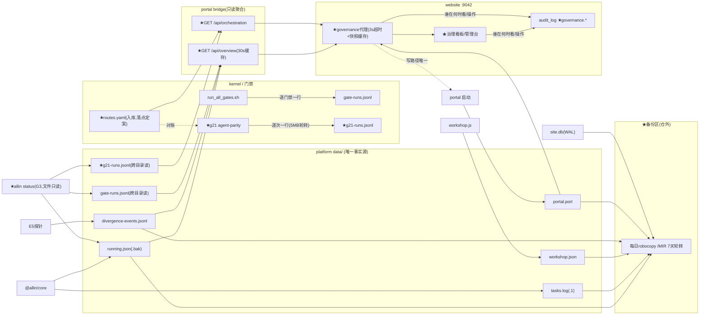

> **本文是 2026-11-05 的一次性记录，不作为约束。**（全栈架构交付专家团产出，经全哥指示随三面贯通升级变更一并归档；原文出自 WorkBuddy 工作区 deliverables/）

# P2 · 数据模型与数据契约 —— allin 三面贯通升级

> **产出人**：储海量（数据建模工程师）｜ **日期**：2026-11-04 ｜ **任务**：#3（P2 专项设计，四人共担）
> **输入**：P1b《总体架构与技术选型》（梁承宇）、P1a《场景定义与MVP范围》（许可研）、
> `platform/data/` 真实状态文件（本机实证）、`platform/packages/core/src/{launch,workshop}.js`（schema 反推）、
> `website/src/db/schema.sql` + `website/src/services/audit.js`、`platform/apps/portal/openapi.yaml`（v0.1.0，13 路径）、
> `SPEC-106-事故分级与响应约定.md` §6。
> **红线**：本文件不改动 allin 仓任何文件；所有「增量」落地时须过既有门禁（g00–g20/g21 / D1–D14 / repocheck）。

---

## 0. 本文件的三个结论（先说结论）

1. **零 schema 迁移**：website 侧本次**不改表、不加列**——治理流水完全复用既有 `audit_log` 五列（action 命名空间扩展即可），`SCHEMA_VERSION` 保持 1。platform 侧只新增**只读端点与运行时产物文件**，无存储引擎变更。全案唯一的「结构性新增」是两个文件：`tools/orchestration/routes.yaml`（入库，落点已定案）与 `tools/gate/audit/g21-runs.jsonl`（g21 判据 JSONL，gitignore 运行时产物）。
2. **文件即事实源，website 不镜像**：治理状态唯一事实源 = platform `data/` 文件 + gate/orchestration 运行时产物（既有纪律）。website 每次实时代理读取，自己只落「谁在何时看/操作了」到 `audit_log`（明文最小列，论证见 §4）。
3. **新文件自动被既有 gitignore 覆盖**：`.gitignore` L80 `/tools/gate/audit/*` 是整目录忽略+白名单放行模式，新增 `g21-runs.jsonl` **无需改 .gitignore**（少一次门禁摩擦）；`platform/.gitignore` 的 `data/` 同理已覆盖 portal.port 等。

---

## 1. 贯通面数据流全景图

### 1.1 数据类清单（生产者 / 消费者 / 存储 / 生命周期 / gitignore）

| # | 数据类 | 生产者 | 消费者 | 存储位置 | 生命周期 | gitignore |
|---|--------|--------|--------|----------|----------|-----------|
| 1 | 项目运行态 `running.json`（含 `.bak`） | `@allin/core launch.js` `writeRunning()`（temp+fsync+rename 原子写，写前备份 .bak） | portal `/api/library` `/api/status`；★`allin status`（G3，文件只读）；★website 代理（经 portal，G1）；★`/api/overview` | `platform/data/running.json` | 活跃态：随启停增删，读取侧**惰性清理**死 pid 条目（`liveRunning()`）；platform 不在运行时该文件**不存在**（已实证：本机 data/ 现仅 divergence-events.jsonl） | ✅ `platform/.gitignore` `data/` |
| 2 | 任务日志 `tasks.log`（+`.1` 归档） | `logTask()`（launch/exit/error/stop-graceful/stop-force） | portal（内部留痕）；★`allin status`（G3） | `platform/data/tasks.log` | 追加式，5MB 轮转归档一代（`rotateIfLarge`） | ✅ 同上 + `*.log` |
| 3 | 工坊状态 `workshop.json` | `workshop.js` `saveState()`（temp+fsync+rename） | portal `/api/workshop` 系 | `platform/data/workshop.json` | 订阅关系持久态，退订删除对应键；文件缺失回退 `{subscriptions:{}}` | ✅ 同上 |
| 4 | 分歧事件 `divergence-events.jsonl` | E5 订阅链路探针 | portal `/api/alerts`（tail 100 条）；★`/api/overview` alerts 段 | `platform/data/divergence-events.jsonl`（本机实证 4332B，真实存在） | 追加式；alerts 只读尾部，无轮转（量级小） | ✅ 同上 |
| 5 | 门户端口发现 `portal.port` | portal 启动（PORT=0 时写入） | ★website 代理（端口发现，BFF 前置）；portal 自身 | `platform/data/portal.port` | 每次启动覆盖；进程退出后残留（陈旧端口 → website 连接失败 → 降级「平台未运行」，P1 R1 已覆盖） | ✅ 同上 |
| 6 | 门禁留痕 `gate-runs.jsonl` | `scripts/run_all_gates.sh` 逐门禁落一行 | portal `/api/gate-history`（tail 200）；★website 管理台（G2，经代理）；★`allin status`（G3）；★`/api/overview` gates 段 | `tools/gate/audit/gate-runs.jsonl`（本机实证 53,968B） | 追加式；5MB 轮转**已定案补做**（Q3，Should 级） | ✅ 根 `.gitignore` L80 `/tools/gate/audit/*`（白名单放行两个 golden/baseline JSON 与 exemptions.csv，不影响新文件） |
| 7 | ★编排路由表 `routes.yaml` | 人写（治理大脑事实源，**入库文件**） | g21 门禁（三方对账）；★portal `/api/orchestration`；★website 控制台（G4，经代理）；SKILL.md / allin.patch.yml 对账 | `tools/orchestration/routes.yaml`【✅ 落点定案（Q2）】 | 随路由变更人工演进；落 tools/ 下**免 docs_index 登记面**（终裁利好），g01 盘符判据照常覆盖 | ❌ 入库（源码级事实源，非运行时产物） |
| 8 | ★g21 判据结果 `g21-runs.jsonl` | g21 门禁（agent-parity，每跑一行；temp 追加写） | ★portal `/api/orchestration`（读**最后一行**=最近快照）；★website 控制台（G4）；★`allin status` 漂移计数（G3） | `tools/gate/audit/g21-runs.jsonl` | 追加式 + 5MB 轮转（沿 tasks.log 模式）；一行=一次运行完整快照；文件缺失 = `readable:false` 不报错（沿 gate-history 惯例） | ✅ 自动被 `/tools/gate/audit/*` 覆盖，**零 .gitignore 改动** |
| 9 | website 业务库 `site.db`（+WAL/SHM） | website 业务路由（AES-256-GCM 加密库） | website 自身；**不镜像治理状态**（架构红线） | `website/data/site.db` | 持久态；WAL 模式 | ✅ `website/.gitignore` `data/` |
| 10 | ★治理审计流水（audit_log 增量行） | website governance 路由（start/stop 成败、看板查看） | website `/admin/governance` 审计过滤视图 | `site.db` 内 `audit_log` 表（复用既有表，**不加列不加表**） | 追加式，永久保留（单机量级极小，见 §4 容量估算）；备份随 site.db | —（库文件级） |
| 11 | ★备份区（仓外） | 每日计划任务 `robocopy /MIR` | 恢复演练（SPEC-106 §6 口径）；SEV1/2 恢复路径 | 仓外目录（如 `D:\allin-backup\`），布局见 §5 | 7 天轮转 | 仓外，天然不入库 |

### 1.2 数据流图（Mermaid，★ = 本方案新增数据边）



### 1.3 一致性与降级语义（契约级约定）

| 场景 | 语义 |
|---|---|
| 读陈旧 | 读操作接受秒级陈旧（library 页 5s 前端刷新惯例）；`/api/overview` 带 30s 内存缓存，响应必带 `generatedAt` 供下游标注 |
| portal 离线 | website 代理 3s 超时 → 返回上次快照 + `stale:true` + 时间戳；无快照则 `degraded:"PORTAL_UNREACHABLE"`，HTTP 200（页面渲染降级提示，不吐 502 原文） |
| 事实源文件缺失 | 全部沿用 gate-history 的 `readable:false` 模式：`routes:[]`、`gates.readable:false`，**绝不 500** |
| 写路径 | 唯一写边：website admin+CSRF → portal 既有 start/stop；同步等待 ActionResult，不引入消息队列；成败均落 audit_log |

---

## 2. `/api/overview` 与 `/api/orchestration` 响应 schema 精化

### 2.1 `GET /api/overview` —— OverviewResponse

设计原则：**聚合既有数据源，零新事实**——每个子段都能追溯到既有端点的一个子集；文件缺失走 `readable:false`/`null`，不报错。

```jsonc
{
  "$schema": "https://json-schema.org/draft/2020-12/schema",
  "$id": "OverviewResponse",
  "type": "object",
  "required": ["generatedAt", "portal", "library", "alerts", "gates", "orchestration"],
  "properties": {
    "generatedAt": { "type": "string", "format": "date-time",
      "description": "本次聚合时刻（ISO-8601 UTC）。缓存命中时为缓存生成时刻，website 代理据此标注快照新鲜度" },
    "portal": {                                  // 透传自 /api/status，恒存在（自己回答自己）
      "type": "object",
      "required": ["version", "uptime", "platform", "port"],
      "properties": {
        "version":  { "type": "string", "example": "0.1.0" },
        "uptime":   { "type": "integer", "minimum": 0, "description": "进程存活秒数" },
        "platform": { "type": "string", "example": "allin-platform" },
        "port":     { "type": "integer", "description": "实际绑定端口（PORT=0 时为发现端口）" }
      }
    },
    "library": {                                 // = /api/library 的计数投影，不搬运 105+ 条明细
      "type": "object", "required": ["total", "running", "invalid", "problems"],
      "properties": {
        "total":    { "type": "integer", "minimum": 0, "example": 107, "description": "登记条目总数" },
        "running":  { "type": "integer", "minimum": 0, "description": "running=true 的条目数" },
        "invalid":  { "type": "integer", "minimum": 0, "description": "valid=false 的条目数（装配问题）" },
        "problems": { "type": "integer", "minimum": 0, "description": "registry 装配问题（problems 数组）条目数——管理台红色徽标直接可用（Q7 采纳）" }
      }
    },
    "alerts": {
      "type": "object", "required": ["last24h", "latestTs"],
      "properties": {
        "last24h": { "type": "integer", "minimum": 0, "description": "最近 24h 分歧事件条数（扫 divergence-events.jsonl 按 ts 过滤）" },
        "latestTs": { "type": ["string", "null"], "format": "date-time", "description": "最近一条事件 ts；无事件为 null" }
      }
    },
    "gates": {                                   // = /api/gate-history 的 summary 投影
      "type": "object", "required": ["readable", "lastRunAt", "lastOkAt", "escapeRate"],
      "properties": {
        "readable":   { "type": "boolean", "description": "gate-runs.jsonl 缺失/不可读时 false，其余字段为 null" },
        "lastRunAt":  { "type": ["string", "null"], "format": "date-time" },
        "lastOkAt":   { "type": ["string", "null"], "format": "date-time" },
        "escapeRate": { "type": ["number", "null"], "minimum": 0, "maximum": 1, "description": "尾部样本失败占比" }
      }
    },
    "orchestration": {                           // = /api/orchestration 的计数投影
      "type": "object", "required": ["readable", "synced", "driftCount"],
      "properties": {
        "readable":    { "type": "boolean", "description": "routes.yaml 或 g21-runs.jsonl 任一缺失时 false" },
        "synced":      { "type": ["boolean", "null"], "description": "readable 且 lastCheckError 为 null 且 driftCount==0；不可读为 null" },
        "driftCount":  { "type": ["integer", "null"], "minimum": 0, "description": "仅计 severity=error 项" },
        "warnCount":   { "type": ["integer", "null"], "minimum": 0, "description": "severity=warn 项计数；g21 未跑过为 null" }
      }
    }
  }
}
```

**示例**（platform 在线、gate-runs 存在、g21 未跑过）：
```json
{
  "generatedAt": "2026-11-04T14:30:00Z",
  "portal": { "version": "0.1.0", "uptime": 137, "platform": "allin-platform", "port": 52134 },
  "library": { "total": 107, "running": 2, "invalid": 0, "problems": 0 },
  "alerts": { "last24h": 3, "latestTs": "2026-11-01T17:36:34.563Z" },
  "gates": { "readable": true, "lastRunAt": "2026-11-04T13:42:11Z", "lastOkAt": "2026-11-04T13:42:11Z", "escapeRate": 0 },
  "orchestration": { "readable": false, "synced": null, "driftCount": null }
}
```
错误响应：仅 `403`（既有 Forbidden，回环围栏不变）；**无 4xx/5xx 新增码**——数据缺失全部在 200 体内表达。

### 2.2 `GET /api/orchestration?include=routes,status` —— OrchestrationResponse

```jsonc
{
  "$schema": "https://json-schema.org/draft/2020-12/schema",
  "$id": "OrchestrationResponse",
  "type": "object",
  "required": ["readable", "routes", "drift", "lastCheckAt", "lastCheckError"],
  "properties": {
    "readable": { "type": "boolean", "description": "routes.yaml 与 g21-runs.jsonl 的可读合取；false 时 routes=[]、drift=[]" },
    "routes": {
      "type": "array",
      "items": { "$ref": "#/$defs/RouteEntry" }
    },
    "drift": {
      "type": "array",
      "items": { "$ref": "#/$defs/DriftFinding" },
      "description": "g21 最近一次运行的判据异常明细：severity=error 与 warn 均进此数组（synced 只看 error）；gate 自身故障不进此数组，走 lastCheckError"
    },
    "lastCheckAt":    { "type": ["string", "null"], "format": "date-time", "description": "g21 最近一次运行时间；未跑过为 null" },
    "lastCheckCommit":{ "type": ["string", "null"], "description": "g21 最近一次运行的短提交号" },
    "lastCheckError": { "type": ["string", "null"], "maxLength": 500,
                        "description": "g21 自身崩溃/不可判定的错误摘要（对应 g21-runs.jsonl 最后一行的 error.msg）；正常运行为 null。**判红条件：lastCheckError 非 null（即最后一行含 error）或 drift 中存在 severity=error 项**，与 g21 侧口径一致" },
    "routesSource":   { "type": "string", "description": "routes.yaml 相对路径，便于前端标注事实源位置", "example": "tools/orchestration/routes.yaml" }
  },
  "$defs": {
    "RouteEntry": {
      "type": "object",
      "required": ["id", "trigger", "entry", "forms"],
      "properties": {
        "id":      { "type": "string", "pattern": "^[a-z0-9-]+$", "example": "deploy-repair" },
        "skill":   { "type": "string", "description": "专项 skill 名（.workbuddy/skills/<skill>）", "example": "dsh-deploy-repair" },
        "entry":   { "type": "string", "description": "入口路径（SKILL.md 相对路径）", "example": "deploy-repair/SKILL.md" },
        "trigger": { "type": "string", "description": "触发条件（人写短语，g21 只做存在性对账不解析语义）" },
        "forms":   { "type": "array", "minItems": 1, "maxItems": 2, "uniqueItems": true,
                     "items": { "enum": ["workbuddy", "dsh"] },
                     "description": "双形态归属：该路由在哪些形态有挂载" }
      }
    },
    "DriftFinding": {
      "type": "object",
      "required": ["routeId", "side", "severity", "reason", "checkedAt"],
      "properties": {
        "routeId":   { "type": "string" },
        "side":      { "enum": ["workbuddy", "dsh", "routes"],
                       "description": "漂移侧：两形态任一，或 routes.yaml 自身条目损坏（锚点解析失败归 routes 侧）。**受控枚举：扩值（如第三形态）须 bump openapi version，随代数演进**" },
        "severity":  { "enum": ["error", "warn"],
                       "description": "error=计入 driftCount 并判红（synced=false）；warn=不红仅提示（如 lastVerified 超龄，agent-app-engineer W301 判据）" },
        "reason":    { "type": "string", "maxLength": 500, "description": "漂移原因 + 修复指引（P1 R2：锚点缺失必须给修复提示）" },
        "checkedAt": { "type": "string", "format": "date-time" }
      }
    }
  }
}
```

查询参数 `include`：`routes,status`（逗号分隔；缺省 = 全量返回；`status` 即 lastCheckAt/drift 段）。保持简单——单机单用户不需要分页。

### 2.3 对既有 openapi.yaml 的增量 diff 清单

| # | 变更 | 位置 | 说明 |
|---|---|---|---|
| 1 | `version: 0.1.0` → `0.2.0` | `info.version` | 字段/枚举只增不改（P1b 决策三），minor 递增 |
| 2 | 新增 path `GET /api/overview` | `paths` | `operationId: getOverview`；新 tag `governance`；description 注明「30s 内存缓存，聚合只读」 |
| 3 | 新增 path `GET /api/orchestration` | `paths` | `operationId: getOrchestration`；同 tag；`include` query 参数 |
| 4 | 新增 tag `governance` | `tags` | description：贯通面只读聚合（website BFF 唯一消费方 + 门户自身） |
| 5 | 新增 schemas | `components/schemas` | `OverviewResponse`、`LibrarySummary`、`AlertsSummary`、`GatesSummary`、`OrchestrationSummary`、`OrchestrationResponse`、`RouteEntry`、`DriftFinding`（结构与 §2.1/§2.2 一致） |
| 6 | 新增 example | 两个新 path | 用 §2.1 示例 + orchestration 示例（含 drift 样例） |
| 7 | **不改** | 既有 13 路径、`loopbackBoundary`、所有既有 schema | 既有端点零改动（P1 §3.1 已锁定） |

> 纪律提醒：openapi.yaml「由真实源码生成」——落地时先写 bridge 端点，再按真实响应回填 yaml，顺序不可倒置（否则契约漂移，正是 g21 要防的那类病）。

---

## 3. g21 判据结果 JSON schema（**冻结版 v3-final：JSONL 逐行**）

> **终裁轨迹**：JSONL（v1 初案）→ 对齐细化（v2：severity/崩溃行禁令/受控枚举）→ 短暂改判单快照 → **主理人 v3 终裁改判回 JSONL 并冻结**（对齐结果实证成立：覆写损坏窗口 + 假绿漏洞两点理由；单快照裁决作废）。本节为冻结口径，后续变更只接受实施阶段实测暴露的问题（走主理人裁决）。

### 3.1 设计取舍（定稿）

- **JSONL 逐行**：判据结果本质是「一次门禁执行的一段留痕」，与 gate-runs.jsonl 同构（日志即事实源纪律）；追加写天然免并发锁，Windows 下无覆写半截损坏窗口。
- **一行 = 一次运行的完整快照**：route×side 逐条进 results 数组，不按 route 拆行——同一运行的条目共享 commit/checkedAt，拆行会破坏「最近一次快照」的原子性。
- **portal `/api/orchestration` 与 `allin status` 只读最后一行**（= 最近一次运行快照），读代价 O(tail)。
- **5MB 轮转沿 tasks.log 模式**（g21 自记历史，不依赖 gate-runs.jsonl——两者互补：gate-runs 记 exit/耗时，g21-runs 记逐路由明细）。
- **gitignore 零改动**（见 §0 结论 3）：`g21-runs.jsonl` 自动被 `/tools/gate/audit/*` 规则覆盖。

### 3.2 行 schema（冻结版）

```jsonc
// 每行一个 JSON 对象（g21 一次执行的完整快照，绝不按 route 拆行）
// —— 正常运行行：
{
  "type": "g21-run",                        // 行类型标识，沿 tasks.log 的 type 惯例，供坏行甄别
  "checkedAt": "2026-11-04T14:00:00Z",      // ISO-8601 UTC（DriftFinding.checkedAt 同源同值）
  "commit": "22e5766",                      // 短提交号（gate-runs.jsonl 同口径）
  "routesFile": "tools/orchestration/routes.yaml",   // 落点已定案（Q2），显式记录防路径漂移
  "routesReadable": true,                   // routes.yaml 缺失/YAML 解析失败时 false
  "results": [
    { "routeId": "deploy-repair", "side": "workbuddy", "ok": true,  "reason": null },
    { "routeId": "deploy-repair", "side": "dsh",       "ok": false, "severity": "error",
      "reason": "锚点 <!-- route:deploy-repair --> 在 allin.patch.yml GOVERNANCE 段缺失；请在对应路由条目处补锚点" },
    { "routeId": "sync-rules",    "side": "workbuddy", "ok": true,  "severity": "warn",
      "reason": "lastVerified 距今 32 天，超过 W301 阈值 30 天；建议复跑该路由验证" }
  ],
  "summary": { "total": 30, "ok": 28, "drift": 1, "warn": 1 }
  // total = Σ(每路由×其声明形态)；drift = Σ(severity=error 且 !ok)；warn = Σ(severity=warn)
}
// —— 崩溃/不可判定行（E2xx：g21 自身崩溃、routes.yaml 解析失败等）：
{
  "type": "g21-run",
  "checkedAt": "2026-11-04T15:00:00Z",
  "commit": "22e5766",
  "routesFile": "tools/orchestration/routes.yaml",
  "routesReadable": false,
  "error": { "code": "E201_ROUTES_UNPARSEABLE", "msg": "routes.yaml YAML 解析失败：line 12 mapping values not allowed" },
  "results": [],
  "summary": { "total": 0, "ok": 0, "drift": 0, "warn": 0 }
}
```

**判红条件（三方统一口径，g21 退出码 / portal / allin status 同款）：**

> `routesReadable == false` **或** 行含 `error` 字段 **或** `summary.drift > 0` ⇒ 红。

崩溃行**必须**携带 `error{code,msg}` 且 `routesReadable:false`——严禁落「total=0/drift=0 且无 error」的假绿行（fail-loud 的核心：**不可判定 ≠ 全绿**）。正常行**不得出现** error 字段（有无 error 本身就是判据信号）。消费方只读 summary 的前提是行内无 error 且 routesReadable=true，此时 drift 才是可信判据。

**字段规约**：

| 字段 | 类型 | 必填 | 说明 |
|---|---|---|---|
| `type` | string | ✅ | 恒 `g21-run` |
| `checkedAt` | string date-time | ✅ | 运行时刻；崩溃行也落盘（fail-loud 留痕，时间线可查） |
| `commit` | string | ✅ | 执行时短提交号 |
| `routesFile` | string | ✅ | 对账对象路径（定案 `tools/orchestration/routes.yaml`，显式记录防漂移） |
| `routesReadable` | boolean | ✅ | false 时 results 为空、summary 归零；**false 本身即判红信号** |
| `error` | object \| 缺失 | 崩溃行必填 | `{code: string, msg: string(≤500)}`；正常运行行**不得出现**该字段 |
| `results[].routeId` | string | ✅ | 与 routes.yaml `id` 一致，`^[a-z0-9-]+$` |
| `results[].side` | enum | ✅ | `workbuddy` \| `dsh` \| `routes`（routes.yaml 自身条目损坏归此侧）。**受控枚举：扩值须 bump version 随代数演进，不提前预留** |
| `results[].ok` | boolean | ✅ | 锚点定位成功且形态声明一致 = true |
| `results[].severity` | enum | 条件必填 | `error` \| `warn`；ok=true 且无告警可省略；**ok=false 恒为 error**（warn 只附在 ok=true 的超龄/降级类提示上，如 W301 lastVerified 超龄——两字段语义不交叉） |
| `results[].reason` | string\|null | ✅ | 失败或 warn 时给「原因+修复指引」（≤500 字符，沿 audit.js 截断惯例）；纯成功 null |
| `summary` | object | ✅ | `total/ok/drift/warn` 四整数；**drift 仅计 error**；platform 与 `allin status` 直接消费，免重算 |

### 3.3 与编排侧（agent-app-engineer）的对齐状态（冻结确认，无遗留分歧）

1. **JSONL 终裁**：其 §2.4 正文本就是 JSONL 设计，恢复有效；「消费最后一行」语义与读法两边一致。
2. **severity 采纳并定规**：ok=false 恒 error；warn 只附 ok=true 超龄/降级提示（现役唯一场景 W301）；summary 四整数（total/ok/drift/warn）。
3. **崩溃行纪律**：error{code,msg≤500} + routesReadable:false 必填、三条件判红、禁假绿、「有无 error 即判据信号」——其确认采纳。
4. **side 受控枚举**：workbuddy/dsh/routes 三值，扩值 bump version。

两边 schema 一致（本文件 §3.2 冻结版 ⇄ agent-app-engineer P2 §2.4/§4.3），**契约冻结，停止设计层互相同步**（主理人冻结令）。

---

## 4. website audit_log 增量：治理操作流水

### 4.1 结论：复用既有表，零 DDL

既有 `audit_log(id, at, actor, action, target, ok, detail)` + `idx_audit_action(action, at)` 完全承载治理流水需求：

| action 值 | 时机 | target | actor | ok | detail（≤500 字符，沿既有截断） |
|---|---|---|---|---|---|
| `governance.entry.start` | 代理转发 portal start 返回后（成败都记） | entry id（如 `cordis-table-app`） | 操作者 display_name（与既有审计 call site 同口径） | portal ActionResult.ok | JSON 摘要：`{"pid":4821}` 或 `{"error":"端口被占用"}` |
| `governance.entry.stop` | 同上 stop | entry id | 同上 | 同上 | `{"graceful":true}` 或 `{"error":"..."}` |
| `governance.view` | 治理看板/管理台页面**加载**时记一次 | `dashboard` \| `admin` | 查看者 | 1 | `{"degraded":"none\|PORTAL_UNREACHABLE\|STALE"}`（降级状态一并留痕） |

**关键纪律——`governance.view` 只在页面加载记，不在前端 5s 轮询的 `/member/api/governance/overview` 上记**。否则：单用户日开 20 次 × 每次会话期数百次轮询 = audit_log 被心跳噪音淹没，真事件（start/stop 失败）不可检索——审计表怕的不是大，是**信噪比死**。

### 4.2 明文最小化论证（为什么这些列不加密）

| 列 | 内容 | 明文必要性 | 加密的代价 |
|---|---|---|---|
| `action` | 枚举值 `governance.*` | **必须明文**：管理台按 action 过滤走 `idx_audit_action(action, at)` 索引；加密即失索引，全表解密扫描 | 违背建库口径「明文只保留必须被索引/排序/统计的最小集合」——action 恰是这个集合 |
| `target` | entry id（`^[a-z0-9-]+$`，registry 公开标识） | 必须明文：同一索引前缀 + 追责定位 | entry id 本身已存在于公开 registry，加密无信息增益 |
| `detail` | ActionResult 摘要（pid/错误文案/降级态） | 明文可接受：**不含**路径、密钥、用户业务载荷；错误文案来自 portal 既有 400 体（本来就无敏感物） | 若未来 portal 错误文案可能含内部路径，则 detail 改为**只存错误码枚举**而非加密（治本在源头裁剪） |
| `actor` | display_name | 与既有登录审计同口径（users.display_name 本就明文） | 单独加密 actor 反而造成同表双口径 |

**威胁模型校验**（对齐 website README §6.5）：加密防线针对「site.db 被拷走 → 业务明文泄露」。治理流水不含任何业务明文载荷，也不含凭据；把明文最小集合扩到「操作元数据」不扩大威胁面。**反例论证（为什么不是全加密）**：安全事件排查恰恰发生在「库可能被动过」的怀疑场景，审计流水若加密，验证其完整性的成本（需密钥+解密链路）会在最需要它的时刻变成障碍——审计元数据明文是行业标准做法（本项目既有 audit_log 亦然）。

**website 不持久化治理状态红线复核**：audit_log 记录的是「事件发生过」这一事实，不是治理状态的镜像——不存 running/漂移/启停结果快照，看板展示数据永远来自实时代理。✅ 无违例。

### 4.3 容量估算（标注假设）

假设：治理操作日均 5 次（含查看）× 365 天 × ~200B/行 ≈ **0.4MB/年**。与既有登录审计同量级，无需保留策略/分区/归档；`detail` 已有 500 字符硬截断兜底。

---

## 5. 备份区数据布局（每日 robocopy /MIR + 7 天轮转）

### 5.1 目录布局（仓外，落点**已定案（Q5）**：`D:\allin-backup\`；**拒绝进仓库目录**——与 backup-key 同纪律，防 git 意外收走）

```
D:\allin-backup\                     # 备份根（仓外；路径写进计划任务参数，不进仓内代码）
├─ 2026-11-04\                       # 日期目录（每日一份，YYYY-MM-DD）
│  ├─ manifest.json                  # 本次备份清单：文件列表+sha256+robocopy 退出码+完成时刻+成败标记
│  ├─ platform-data\                 # robocopy /MIR platform\data → 全量镜像
│  │  ├─ running.json / running.json.bak
│  │  ├─ tasks.log / tasks.log.1
│  │  ├─ workshop.json
│  │  ├─ divergence-events.jsonl
│  │  └─ portal.port                 # 恢复价值低但镜像无害（含在 /MIR 内）
│  └─ website-data\
│     ├─ site.db
│     ├─ site.db-wal                 # WAL 模式三件套必须同份镜像（见 5.3）
│     └─ site.db-shm
├─ 2026-11-03\ ...
└─ 2026-10-28\ ...                   # 仅保留最近 7 份，脚本按目录名删除过期项
```

**不含项**（显式排除）：
- `platform/workshop-copies/`——git 浅克隆副本，可由 subscribe 重建，镜像它只会拖慢备份且体积不可控；
- `website/keys/`——密钥**绝不走 robocopy**：密钥灾备唯一通道 = 既有 `npm run backup-key`（0600、带口令包）。两通道物理隔离，防止「数据镜像泄漏=密钥连带泄漏」的单点共因失效。

### 5.2 7 天轮转实现

计划任务每日一次（与备份同任务串行执行）：
1. `robocopy /MIR` 各源 → `当日目录`（robocopy 退出码 `<8` = 成功；`≥8` = 失败，manifest 标 `failed` 并 stderr 告警——robocopy 的 0–7 是「含复制的成功」语义，**不能**按传统退出码判成败）；
2. 写 `manifest.json`（逐文件 sha256，单机量级 <100MB，秒级完成）；
3. 按目录名排序删除超出 7 份的最旧目录（按目录名日期而非 mtime，防 mtime 被 touch 干扰）。

### 5.3 与 backup-key 密钥灾备包的关系

| | 每日数据镜像（本节） | backup-key（既有） |
|---|---|---|
| 对象 | platform/data + website/data（site.db） | website 密钥材质（keys/） |
| 形态 | 明文文件镜像（仓外 7 份滚动） | 口令加密包 + 0600 |
| 频率 | 每日自动（计划任务） | 手动 + 月度演练（SPEC-106 §6） |
| 恢复顺序 | **先** restore-key（密钥就位）**后**拷回 site.db | — |

依赖关系：site.db 密文没有密钥即废纸——**密钥包必须比数据镜像更长寿**（月度演练保证；建议密钥包至少留存跨多个月度，不参与任何滚动删除）。

### 5.4 恢复演练验证清单（对照 SPEC-106 §6 口径；演练记录落 `docs/记录/` + 登记 INDEX.md）

| # | 验证项 | 命令/动作 | 期望 |
|---|---|---|---|
| 1 | 密钥恢复 | `npm run restore-key -- --from <包> --passphrase …` | exit 0（SPEC-106 §6 密钥灾备行） |
| 2 | 加密完整性 | `npm run verify:crypto` | 10/10 绿 |
| 3 | site.db 恢复 | 停 website → 拷回 site.db 三件套（db+wal+shm）→ 起服务 | smoke 19/19 绿 |
| 4 | site.db 一致性 | `node -e "…PRAGMA integrity_check"`（或 smoke 内含） | `integrity_check: ok` |
| 5 | platform 状态恢复 | 拷回 platform/data → 启 portal → `GET /api/status` | 200；running.json 可解析且与 .bak 无冲突（损坏时 launch.js 已有 .bak 回退） |
| 6 | 门禁留痕恢复 | 拷回 gate-runs.jsonl → `GET /api/gate-history` | readable:true，tail 可解析 |
| 7 | manifest 复核 | 备份目录 manifest.json 的 sha256 抽验 2 个文件 | 哈希一致 |
| 8 | 记录闭环 | 演练记录落 docs/记录/，INDEX.md 登记 | 门禁绿（文档税已知，P1a R6） |

### 5.5 已知风险与对策

| 风险 | 对策 |
|---|---|
| SQLite WAL 三件套在 robocopy 单次复制内非原子（写入恰在拷贝中途 → 快照不一致） | **已定案（Q4）**：备份脚本先 `PRAGMA wal_checkpoint(TRUNCATE)`（一行脚本换确定性）再拷贝三件套；演练清单 #4 `integrity_check` 兜底 |
| robocopy 退出码误判（0–7 是成功） | manifest 按退出码 `<8` 判定，脚本内写死并注释 |
| 备份根目录被误删/磁盘同盘单点 | **已定案（Q5）**：暂定 `D:\allin-backup\`（与 C 盘工作区异盘；D 盘现役 405G 余量充足）；若实施时改落点，仅计划任务参数变化、脚本零改动。单人团队接受「同机异盘」底线，不做异地 |

---

## 6. 数据迁移与兼容

### 6.1 变更清单与迁移策略

| # | 变更 | 类型 | 迁移动作 | 兼容性 | 回滚 |
|---|---|---|---|---|---|
| 1 | website audit_log 记 `governance.*` 流水 | **零 DDL**（既有表+既有列） | 无——audit.js 不改，路由层调 `logAudit()` 即可；`SCHEMA_VERSION` 保持 1，`migrations` 数组继续空置 | 旧数据天然兼容（同一张表追加新 action 枚举值；`action` 无 CHECK 约束，无需迁移）✅ | 无需回滚（多余行无害；如需清理 `DELETE WHERE action LIKE 'governance.%'`） |
| 2 | 新增 `tools/orchestration/routes.yaml` | 入库新文件 | 无 DB 迁移；落点**已定案**（Q2）；g21 与 portal 的路径常量按定案一次性统一 | 文件缺失时 g21 红（fail-loud，符合预期）+ `/api/orchestration` readable:false（降级，不炸）✅ | 删文件 + 回退引用它的两个增量端点 |
| 3 | 新增 `tools/gate/audit/g21-runs.jsonl`（g21 判据 JSONL） | 运行时产物 | 无（gitignore 已覆盖；首次 g21 运行自动创建；追加写 + 5MB 轮转） | 缺失 = readable:false ✅；崩溃行必填 error+routesReadable:false（禁假绿） | 删文件即可，下轮运行重建 |
| 4 | portal 新增 2 只读端点 | 代码增量 | 无存储变更 | openapi 0.1.0→0.2.0，既有字段只增不改，旧消费者（门户 SPA）不受影响 ✅ | 下线端点；website 代理自动降级为 PORTAL_UNREACHABLE 语义 |
| 5 | website 新增 governance 路由组/页面 | 代码增量 | 无存储变更（§4 已定零 DDL） | smoke 19 项为**加法**：新增用例只增不减 | 回退路由文件，无数据残留 |
| 6 | 备份计划任务（仓外） | 运维增量 | 无仓内变更；新增任务注册脚本（仓外执行） | portal 不在线时 robocopy 照常（data/ 文件仍在） | 删除计划任务 + 备份目录 |

### 6.2 website node:sqlite 幂等建表现状与扩展路径（供未来参考）

现状（`website/src/db/index.js`）：`applySchema()` 整份执行 schema.sql（全 `CREATE TABLE IF NOT EXISTS`，幂等），`schema_meta` 记版本；版本**高于**代码支持值时 fail-loud 拒启（防旧代码开新库）。预留的 `migrations` 数组模式是正确扩展点，本期用不上；**未来若需加列**，纪律是：
1. `SCHEMA_VERSION` +1，在 migrations 按 `from→to` 追加幂等步骤（SQLite 加列用 `ALTER TABLE ADD COLUMN`，探列存在再执行）；
2. 禁止改写既有列语义（「只增不改」与 openapi 同款纪律）；
3. 每个迁移步骤配套回滚说明（哪怕结论是「不可回滚，须备份先行」）。

### 6.3 旧数据兼容专项检查

- audit_log 既有行（登录/越权/解密失败）与新 governance.* 行共存于同一索引 `idx_audit_action(action, at)`——`LIKE 'governance.%'` 过滤在管理台用即可，无需新索引（量级见 §4.3，全表扫描都无压力）。
- running.json/tasks.log/workshop.json 读取方新增（allin status、bridge）全部走**只读**，且沿用「文件缺失→降级值」惯例，对旧文件（无 .bak、无 .1 归档的老格式）零要求。

---

## 7. 风险与借鉴记账

### 7.1 风险

| # | 风险 | 影响 | 缓解 |
|---|---|---|---|
| RD1 | gate-runs.jsonl **当前无轮转**（实证 53KB 缓慢增长） | 门禁留痕无限膨胀（低危，年增约 MB 级） | **已定案（Q3，Should）**：run_all_gates.sh 补同款 5MB `rotateIfLarge`，本期实施范围内做 |
| RD2 | WAL 三件套镜像非原子（§5.5） | 恢复点不一致 | **已定案（Q4）**：备份脚本先 `PRAGMA wal_checkpoint(TRUNCATE)` 再拷贝；演练清单 #4 integrity_check 兜底 |
| RD3 | routes.yaml 落点漂移风险 | g21/portal/`allin status` 三方路径常量不一致 | **已定案（Q2）**：tools/orchestration/routes.yaml；routesFile 字段在快照中显式落盘，漂移可被三方对账发现 |
| RD4 | `governance.view` 若误接进轮询接口，audit 信噪比崩坏 | 审计不可用 | §4.1 已写死「仅页面加载记」；code review 检查项 |
| RD5 | 备份同机单盘单点 | 灾备失效（SEV2：有恢复路径但单点） | 【待确认】第二块盘；单人团队接受底线 |
| RD6 | website 代理把 portal 403（围栏被改）透传成页面错误 | fail-loud 噪音 | P1b 已定 PORTAL_FORBIDDEN 分类报警；本契约补充：403 属**配置事故**不落快照缓存，直接报警页（区别于超时的 stale 快照） |

### 7.2 借鉴记账

| 来源 | 许可 | 借用范围 |
|---|---|---|
| 本仓既有资产：`platform/packages/core/src/{launch,workshop}.js`（原子写/轮转/JSONL 纪律）、`website/src/db/{index.js,schema.sql}`、`website/src/services/audit.js`、`openapi.yaml` v0.1.0、SPEC-106 §6、P1a/P1b 交付物 | MIT-0 / MIT | 直接依据，非外部借鉴；列出以便回溯 |
| SQLite 官方文档（WAL 模式与备份语义：db+wal+shm 须一并考虑、checkpoint 语义） | Public Domain | 论据引用（§5.5），未复制任何文本/代码 |
| Microsoft Robocopy 文档（退出码 0–7=成功语义） | 微软文档 | 论据引用（§5.2），未复制任何脚本 |

> 本文件为纯仓内建模 + 通用工程知识引用，无外部代码/配置借鉴。

---

## 8. 裁决记录（Q1–Q7 已全部拍板，2026-11-04 主理人收口）

| # | 事项 | 裁决 | 落点 |
|---|---|---|---|
| Q1 | g21 判据产物形态 | **冻结为 JSONL 逐行 `tools/gate/audit/g21-runs.jsonl`**（v3 终裁改判回 JSONL，单快照裁决作废；判据：覆写损坏窗口 + 假绿漏洞）；severity/崩溃行纪律/side 三值枚举全部保留 | §3 冻结版 v3-final 已按此定稿 |
| Q2 | routes.yaml 落点 | **定案 `tools/orchestration/routes.yaml`**（我方倾向被采纳）；免 docs_index 登记面，g01 盘符判据照常覆盖 | §1.1 #7、§6.1 #2 已更新 |
| Q3 | gate-runs.jsonl 5MB 轮转 | **采纳做**，定级 Should（本期实施范围内） | RD1 缓解已标注 |
| Q4 | WAL checkpoint 预处理 | **采纳做**：`wal_checkpoint(TRUNCATE)` 进备份脚本 | §5.5、RD2 已更新 |
| Q5 | 备份根落点 | **暂定 `D:\allin-backup\`**（与 C 盘异盘）；portal.port 保留镜像不做特判；改落点仅计划任务参数变化 | §5.5 已更新 |
| Q6 | governance.view 覆盖管理台 | **采纳**：target='admin' 覆盖 /admin/governance 页访问（原文已含，确认无修改） | §4.1 |
| Q7 | overview 增 problems 计数 | **采纳**：OverviewResponse.library 增 `problems:integer` | §2.1 已更新 |

---

*本文件为 P2 阶段交付物，存放于 team 工作区，不落入 allin 仓；落地时相关增量按 SPEC-002 流程过门禁并回写 SPEC-204 增量章节。*
